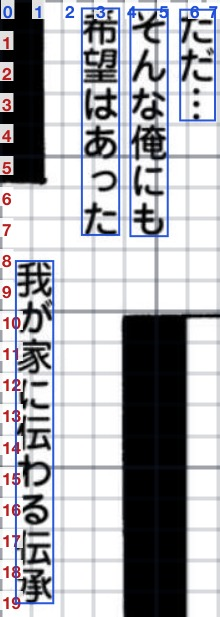
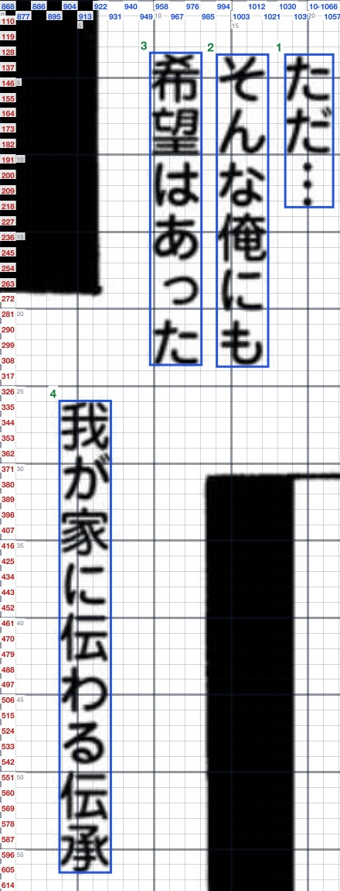

# Loop record — label drift

- **When** 2026-11-18 01:53:20 → 02:43:02 (Hong Kong time)
- **Where** comic translator, the block reader (`src/lib/ocr/cloudOcr.ts`, `grid.ts`, `blockCrop.ts`)
- **Rounds** 3, then a second budget of 2 at the user's choice
- **Outcome** met: every label frame on its ink, 35/35 over three runs of each page; `npm run regression` 9/9

## The three questions

**What should change.** A translated line was landing beside its column. The
reader was asked where each line sat, as a cell box on a grid drawn on the
crop, and the answer became the label's frame. The positions it gave were 20
page pixels out at best and a whole column at worst, so the labels drifted.

**How to verify.** `npm run grid:drift` — a new script that runs detection on a
page and compares the frame each label is drawn on with the ink boxes the
detector drew on the reader's crop. Two pages, `fixtures/page-wizard.jpg` and
`fixtures/page-office.jpg`, added with `fixtures/drift.json`.

**Done when.** Every label's frame within 8 page pixels of its ink on both axes
and within 25% of its size, on both pages, in two clean runs, with
`npm run regression` green. Budget 3 rounds; "another two" granted after the
third.

## The check, and what the old pipeline measured

```
npm run grid:drift -- --all        # both pages, live reading
npm run grid:drift -- --detection out/eval/det-wizard.json   # replay, no network
```

Baseline on the old pipeline, measured at 01:56 on the page that failed:
8 of 15 lines failed, worst dx 16.4 / dy 29.9,
frames 0.38–1.45× the size of their ink. The 900,135 caption came back with a
50 px frame on a 28 px glyph, so its label was centred 11 px off and drawn at
twice the size before the fit shrank it.

## Rounds

| # | when (Hong Kong) | change | result | what the failure said |
|---|---|---|---|---|
| 0 | 2026-11-18 01:56:01 | wrote `scripts/grid-drift.mjs`, measured the old pipeline on the page that failed | 8/15 failed | the metric reproduces the complaint; the frames are the reader's own boxes |
| 1 | 2026-11-18 02:02:16 | cell from ~1/20th of the long side to ~20 canvas px (≈1/3 glyph); crop 220→440 on the short side; every grid line prints its **page coordinate**; prompt asks for page pixels | failed | the model cannot read turned digits: asked for the top row it answered 62 for the line printed 42, then estimated the boxes. It also mixes units — x in image pixels, y in page pixels on the same line |
| 2 | 2026-11-18 02:06:18 → 02:11:05 | column numbers laid flat, staggered over two rows; frame taken from the detector's blue boxes (band match), font from that frame | 9/10 | one line's band held no box at all — the reader's estimate landed in the gap between two columns |
| 3 | 2026-11-18 02:15:03 | (budget spent; reported not-done with options) | — | user chose "number the blue boxes", new budget of 2 |
| 4 | 2026-11-18 02:21:20 → 02:27:06 | green number on every blue rectangle; prompt returns `box`; the frame *is* that rectangle. Furigana boxes no longer drawn | 35/35, guards 9/9 | — |

`name-plate` went green in round 4 for a reason worth writing down: the region
boxes became the named rectangles, so `dropRepeatedReadings` finally saw the
loose block's line lying on the tight block's ink. The loose block's *words*
already matched — `spokenGlyphs` drops spaces — so the space strip that was
tried first changed nothing, and it was reverted.

## What changed

### The crop the reader is sent

Rendered at 2026-11-18 02:41:30 from the same block and the same detector boxes,
the old module against the new one:




| area | before | after | why |
|---|---|---|---|
| crop | block + 10 px margin, 177×496 | same, plus a ruler strip (22 px left, 24 px top) | the numbers need a strip of their own; drawn over the block they cover the column they describe |
| upscale | 220 px short side, 1600 max | 440 px, 2000 max | a fine grid on a small crop is a grey moire over the text it is meant to measure |
| grid | 20 cells on the long side (~25 page px, one per glyph) | ~20 canvas px between lines (~9 page px, a third of a glyph) | one cell per glyph is why the cell box doubled |
| numbers | cell index only, on the two edges (0…6, 0…19) | every line prints **its page x or y**; top row flat and staggered over two rows; index in grey every fifth | a page coordinate needs no multiplication and no counting between neighbouring numbers |
| blue boxes | 4 rectangles | 4 rectangles, each with a green **id** | naming a rectangle is a choice; measuring one is an estimate |
| furigana | a blue box drawn around the reading | not drawn | a 21 px reading box beside a 44 px column was handed to a text line |

The number on a line is the page coordinate, not a count: a line printed 1035
is x 1035. The id is the position that matters — the rectangle is already the
ink.

### The answer the reader gives

| before | after | why |
|---|---|---|
| `{"x":12,"y":2,"width":5,"height":28}` — the cells holding the line | `{"box":2,"x":1035,"y":133,…}` — the id of the rectangle that holds it; coordinates only as a fallback | the cell box rounds up (a 30 px glyph touching two 25 px cells is *two cells wide*), and a measured coordinate was 20 page px out at best, a column at worst |
| the label frame was the reader's box | the frame is the named rectangle; the label is centred on it | the rectangle is the ink, the estimate is not |
| the font was `cells × cell`, or the box's side when no cells came back | the font is the frame's width across the line | the cell count doubled the font on every glyph that spanned two cells |
| a region's box was whatever the reader estimated, snapped to cells | a region's box is the rectangle it named | the nested-block repeat guard compares boxes as well as words; on estimates the plate was translated twice, on rectangles it matches |

### What did not change

- one crop per block, one request per block, JPEG 0.92, reading at no thinking;
- the erase area: the ruler strip is added by `readerCropBox` only, so nothing
  new is erased;
- the rule that one entry is one column, and the furigana rules in the prompt.

### The diff

- `src/lib/ocr/grid.ts` — cell size, page coordinates on every line, staggered top rows, index on the fifths
- `src/lib/ocr/blockCrop.ts` — upscale, ruler strip, numbered boxes
- `src/lib/ocr/cloudOcr.ts` — prompt, box-id parsing, frame assignment, furigana boxes, `inkOf`
- `src/offscreen/main.ts`, `src/shared/types.ts` — the frame is the slot; per-line `frames`/`inks` for the check
- `scripts/grid-drift.mjs`, `fixtures/drift.json` — the check
- `docs/regression.md#placement-where-the-label-lands`, `docs/detection-pipeline.md#the-drawn-grid`

## Left over

- Reading quality still varies. A column the reader never names is a box with no
  text, so nothing shifts any more, but that column's translation is lost for the
  run. The 魔法使い block did it once.
- The crop is twice the side, so roughly four times the image tokens per block.
- The two fixture pages are the check's input and should be committed with it.
